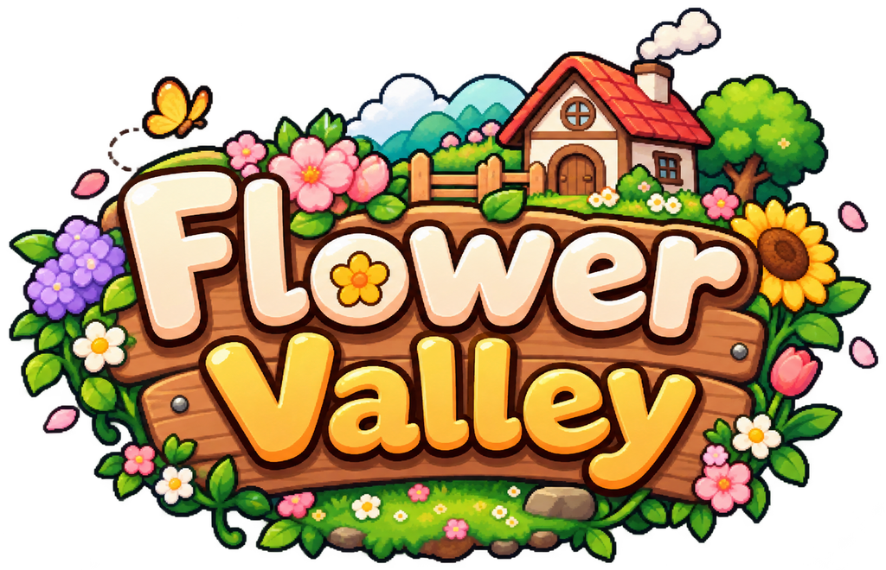

# 🌷 Flower Valley

<p align="center"></p>

โลกเสมือนแบบ 3 มิติที่สร้างด้วย **A-Frame 1.7.1** ส่วนหน้าจอเกมทำด้วย **React + TypeScript** เป็นเกมสโลว์ไลฟ์ ปลูกดอกไม้ ตกปลา วาดรูป และเดินเที่ยวได้ 6 ฉาก เล่นได้ทั้งคีย์บอร์ด/เมาส์และจอสัมผัส ความคืบหน้าเก็บไว้ใน localStorage ของเบราว์เซอร์

**เล่นออนไลน์:** https://flower-valley-beige.vercel.app/

---

## ✨ สิ่งที่ทำได้

### 🗺️ เดินเที่ยว 6 ฉาก
เดินเข้าฉากใดก็ตามจะมีป้ายชื่อขึ้นบนจอ และวาร์ปข้ามฉากได้จากแผนที่ (M → "วาร์ปไปยังฉาก") โดยไม่เสียเวลาหรือพลังงาน

| # | ฉาก | สิ่งที่มี |
|---|---|---|
| 1 | **Flower Village** หมู่บ้านดอกไม้ | ตลาด ร้านค้า NPC และห้องศิลปะของโอลิเวอร์ |
| 2 | **Garden & Home** สวนและบ้าน | แปลงปลูก บ้าน สวนหลังบ้าน บ่อปลา และธีโอช่างก่อสร้าง |
| 3 | **Mirror Lake** ทะเลสาบกระจก | ตกปลาน้ำจืดและกองไฟย่างปลา |
| 4 | **Breezy Beach** ชายหาด | ตกปลาทะเลบนท่าเรือ ประภาคาร เรือ นกนางนวล ฝูงปลาและแมงกะพรุนใต้ท่าเรือ |
| 5 | **The Deep Woods** ป่าลึก | ของป่า 12 จุดที่งอกใหม่ทุกเช้า ลำธารที่เดินลุยได้ แคมป์ กองไฟ งูและสไลม์ |
| 6 | **Skyhill Lookout** จุดชมวิวเนินฟ้า | น้ำตกและลำธาร ลานชมวิว กล้องส่องทางไกลที่ซูมไปยังฉากต่าง ๆ ได้ ธงโลโก้ และว่าว |

แต่ละฉากมีรั้วกั้นและต้องเข้าทางประตู ทะเลเดินลงไม่ได้ (ยกเว้นบนท่าเรือ) และความสูงของตัวละครจะเปลี่ยนตามเนินเขาและท่าเรือ

### 🌱 ปลูกดอกไม้
- เริ่มเกมด้วย 500 เหรียญ พลังงาน 100 และแปลงว่าง 3 แปลง
- ดอกไม้ 7 ชนิด ได้แก่ เดซี่ ทิวลิป ทานตะวัน กุหลาบ ลาเวนเดอร์ คอสมอส และไฮเดรนเยีย แต่ละชนิดใช้เวลาโตและขายได้ราคาไม่เท่ากัน
- ดอกไม้จะโตเมื่อรดน้ำแล้วข้ามวัน และวันที่ฝนตกจะรดน้ำให้เอง
- ปุ๋ย 3 ระดับช่วยเร่งการเติบโตได้ 1/2/3 วัน
- ขยายสวนได้ถึง 20 แปลง และอัปเกรดบัวรดน้ำให้รดได้ทีละหลายแปลง

### 🎣 ตกปลา
- มินิเกมกดปุ่ม A/D ให้ตรงลำดับภายในเวลาที่กำหนด
- ปลาน้ำจืด 6 ชนิดที่ทะเลสาบ และปลาทะเล 5 ชนิดที่ท่าเรือ (ปลาทู ปลากะพง ปลาการ์ตูน ปลาทูน่า แมงกะพรุน)
- อัปเกรดคันเบ็ดเพื่อเพิ่มโอกาสได้ปลาหายาก บางครั้งจะได้ขยะแทน
- ย่างปลาทุกชนิดได้ที่กองไฟ ปลาย่างขายได้แพงขึ้น 50% หรือกินเพื่อเพิ่มพลังงาน
- ปล่อยปลาทุกชนิดลงบ่อที่บ้านได้ ปลาจะว่ายให้เห็นในบ่อ

### 💐 ค้าขายและเศรษฐกิจ
- ร้านค้าของ NPC แต่ละคน: ลิลลี่ขายเมล็ดและปุ๋ย เมย์รับซื้อดอกไม้ ฟินน์รับซื้อปลาและขายคันเบ็ด โรวันรับซื้อของป่าและขยะ โนราขายอาหาร
- จัดช่อดอกไม้จากดอกไม้ 3 ดอก ขายได้ 1.25 เท่าของราคารวม และมีลูกค้าสั่งช่อดอกไม้ทุกวัน
- ร้านเปิด 07:00–20:00 และ NPC เดินไปทำงานและกลับบ้านตามเวลา

### 🎨 งานศิลปะ
- วาดรูปบนผ้าใบ ตั้งชื่อ บันทึก และส่งออกเป็นไฟล์ PNG
- ระบายสีโมเดลสัตว์ 3D 5 ตัว (แมว หมา กระต่าย เต่า หนูแกสบี้) แล้วหมุนดูได้
- ผลงานที่ยังไม่ขายจะแสดงในแกลเลอรีของห้องศิลปะ และขายให้โอลิเวอร์ได้วันละ 1–2 ชิ้น

### 🏡 บ้านและการตกแต่ง
- เปลี่ยนสีบ้าน ซื้อสวนหลังบ้าน บ่อปลา กระถางดอกไม้ ซุ้มไม้ และม้านั่ง
- ใช้เตียงนอนพักเต็มพลังงาน หรือพักเติมพลังงานบนขอนไม้และม้านั่งได้

### ⏰ เวลา อากาศ และบรรยากาศ
- เวลาในเกมเดิน 2 นาทีต่อ 1 วินาทีจริง และหยุดเมื่อเปิดเมนู
- กลางวันกับกลางคืนมีแสงต่างกัน และมีโอกาสฝนตกวันละ 30%
- เอฟเฟกต์พิกเซลอาร์ต: ฝน ดาวตก แสงเหนือ หิ่งห้อย ใบไม้ร่วง นก ผีเสื้อ น้ำตก และฟองน้ำ
- มีเพลงพื้นหลังและเสียงประกอบ ปรับระดับเสียงได้ในหน้าตั้งค่า

---

## 📅 กำหนดการ

### ไทม์ไลน์การพัฒนา

| ช่วงเวลา | งาน | สถานะ |
|---|---|---|
| 25–26 ก.ย. 2026 | โครงเกม A-Frame + React, ปลูกดอกไม้, ตกปลา, งานศิลปะ, โมเดล NPC | ✅ เสร็จ |
| 28–30 ก.ย. 2026 | กองไฟย่างปลา, ปรับหมู่บ้าน, บ้านและบ่อปลา, ร้านอาหาร | ✅ เสร็จ |
| 1–7 ต.ค. 2026 | ปรับเศรษฐกิจในเกม, ไอคอนปลา, จุดพักที่บ้าน | ✅ เสร็จ |
| 25 ต.ค. 2026 | เพิ่ม 3 ฉากใหม่ (ชายหาด ป่าลึก เนินฟ้า) ให้ครบ 6 ฉาก + ขึ้นเว็บ Vercel | ✅ เสร็จ |
| 7–8 พ.ย. 2026 | บ่อปลาไม่จำกัดจำนวน, ว่าวใหม่, เอฟเฟกต์พิกเซลอาร์ต | ✅ เสร็จ |
| 10 พ.ย. 2026 | น้ำตกและลำธาร, ขอบเขตการเดินและรั้ว, โลโก้, ปลาทะเล, เกมเบาลง | ✅ เสร็จ |

### สิ่งที่วางแผนไว้ต่อ

- [ ] ทดสอบบน iPad และมือถือจริง (ยังไม่ได้ทดสอบบนอุปกรณ์จริง)
- [ ] วัดความลื่นของเกมบนเครื่องสเปกต่ำ และปรับให้เบาลงอีก
- [ ] แยกไฟล์ JavaScript ให้โหลดหน้าแรกเร็วขึ้น (ตอนนี้ไฟล์หลักใหญ่ประมาณ 1.9 MB)

---

## 🆕 การอัปเดตที่ทำไปแล้ว

เรียงจากล่าสุดไปเก่าสุด ดูรายละเอียดเต็มได้ที่ [`docs/PROGRESS.md`](docs/PROGRESS.md)

### 10 พ.ย. 2026: น้ำตก ลำธาร โลโก้ และปลาทะเล
- ย้ายน้ำตกไปขอบเนินฝั่งไกล เดินขึ้นเนินแล้วจะเห็นตรงหน้าพอดี และเพิ่มลำธารไหลลงเนิน
- ขยายพื้นที่เดิน เพิ่มรั้วกั้นขอบหุบเขา ต้องเข้าแต่ละฉากทางประตู และกันทะเลไม่ให้เดินลงไป
- ธงบนเนินเขาและไอคอนแท็บเว็บเปลี่ยนเป็นโลโก้ Flower Valley
- ไอคอนปลาทะเลชุดใหม่ ตกแมงกะพรุนได้ ปลาทะเลย่างได้และเลี้ยงในบ่อได้
- ลดความหนาของฝน และเอาจุดกลมกลางจอออก
- ดอกไม้ในทุ่งใช้รูปทรงที่เบาลง จำนวนสามเหลี่ยมที่ต้องวาดลดจากประมาณ 4.8 ล้านเหลือ 2.0 ล้าน

### 8 พ.ย. 2026: เอฟเฟกต์พิกเซลอาร์ต
- ฝน ดาวตก แสงเหนือ หิ่งห้อย ใบไม้ร่วง นก ผีเสื้อ นกนางนวล ฝูงปลา แมงกะพรุน งู สไลม์ น้ำตก และฟองน้ำ จากไลบรารี pixelfx (MIT)

### 7 พ.ย. 2026: บ่อปลาและว่าว
- บ่อปลาที่บ้านเลี้ยงปลาได้ไม่จำกัด มีปุ่มปล่อยและนำกลับทีละตัวหรือทั้งหมด
- ออกแบบว่าวบนเนินเขาใหม่ 2 ตัว

### 25 ต.ค. 2026: 3 ฉากใหม่และขึ้นเว็บ
- เพิ่มชายหาด ป่าลึก และเนินฟ้า รวมเป็น 6 ฉาก พร้อมเมนูวาร์ป
- ตกปลาทะเล เก็บของป่า และกล้องส่องทางไกล
- ขึ้นเว็บบน Vercel

### 7 ต.ค. 2026: ไอคอนปลาและจุดพัก
- ไอคอนปลาชุดใหม่ แก้ไอคอนปลาคาร์ปโคอิที่แสดงผิด
- อัปเกรดบ้านระดับ 3 แล้วพักบนม้านั่งได้ +40 พลังงาน

### 1–2 ต.ค. 2026: ปรับสมดุลเกม
- ปรับราคาปุ๋ย อาหาร และโอกาสได้ปลาหายาก
- ตกปลาครั้งละ 10 พลังงานและ 15 นาทีในเกม
- จำกัดจำนวนงานศิลปะที่ขายได้ต่อวันแทนการจำกัดตอนสร้าง
- พระอาทิตย์ พระจันทร์ และควันจากปล่องไฟ

### 28–30 ก.ย. 2026: บ้าน ร้านค้า และกองไฟ
- กองไฟย่างปลาและขอนไม้สำหรับนั่งพัก
- ปลาเพิ่มเป็น 6 ชนิด คันเบ็ดอัปเกรดได้ และบางครั้งได้ขยะ
- สีบ้าน สวนหลังบ้าน บ่อปลา กระถาง ซุ้มไม้ ม้านั่ง
- ร้านอาหารของโนรา
- อัปเกรดพลังงานได้ถึง 200

### 25–26 ก.ย. 2026: เริ่มโปรเจกต์
- โครงเกมหลัก ปลูกดอกไม้ ตกปลา จัดช่อดอกไม้ วาดรูป และระบายสีโมเดลสัตว์
- โมเดล NPC ระบบเวลาและอากาศ และการบันทึกเกม

---

## 📌 อื่นๆ

### วิธีรันบนเครื่อง

ต้องใช้ Node.js 20.19+ หรือ 22.12+

```sh
npm install
npm run dev
```

เปิดลิงก์ localhost ที่ Vite แสดง ถ้าจะเล่นบน iPad หรือมือถือที่ต่อ Wi-Fi เดียวกัน ให้ใช้ลิงก์ Network ที่ Vite แสดงแทน

```sh
npm test         # รันเทสต์
npm run build    # build สำหรับขึ้นเว็บ
npm run preview  # เปิดดูไฟล์ที่ build แล้ว
```

### ปุ่มควบคุม

| ปุ่ม | การทำงาน |
|---|---|
| W A S D | เดิน |
| Shift + เดิน | วิ่ง (ไม่เสียพลังงาน) |
| คลิกในฉาก | ล็อกเมาส์เพื่อหันมอง (ถ้าล็อกไม่ได้ ให้ลากเพื่อหันมอง) |
| E | คุยกับ NPC หรือใช้ของที่อยู่ใกล้ |
| Space | รดน้ำแปลงที่เล็งอยู่ / เหวี่ยงเบ็ด |
| Q | ดูรายละเอียดแปลง |
| I / M / B | กระเป๋า / แผนที่ / สารานุกรมดอกไม้ |
| Esc | ปิดหน้าต่าง / หยุดเกม / ปล่อยเมาส์ |
| มือถือ/iPad | จอยสติกซ้ายเพื่อเดิน ลากจอเพื่อหันมอง ปุ่ม E บนจอเพื่อใช้ของ |

### โครงสร้างโปรเจกต์

```text
src/
  components/    หน้าจอเกม ตกปลา ย่างปลา วาดรูป และการนอน
  game/          สถานะเกม เศรษฐกิจ ข้อมูลไอเท็ม การบันทึก และเทสต์
  world/         ฉาก A-Frame การเดิน อาคาร NPC และธรรมชาติ
  vendor/pixelfx เอฟเฟกต์พิกเซลอาร์ต (MIT)
  dev/           ปุ่ม QA สำหรับทดสอบ (เปิดด้วย ?qa ตอน dev เท่านั้น)
  App.tsx        หน้าจอหลักและการเชื่อมต่อกับโลก 3D
public/
  models/        โมเดล 3D ที่ใช้ในเกม
  textures/      พื้นผิว อาคาร และท้องฟ้า
  icons/         ไอคอนพิกเซลอาร์ต โลโก้
docs/
  ASSET_CREDITS.md   แหล่งที่มาและสัญญาอนุญาตของโมเดลและภาพ
  PROGRESS.md        ประวัติการพัฒนาและการทดสอบโดยละเอียด
  BALANCE_AUDIT.md   การตรวจสมดุลเศรษฐกิจในเกม
workflow.md      สเปกเกมต้นฉบับ
```

### เทคโนโลยีที่ใช้
- [A-Frame](https://aframe.io/) 1.7.1 และ three.js สำหรับโลก 3 มิติ
- React 19 และ TypeScript สำหรับหน้าจอเกม
- Vite สำหรับ dev server และการ build, Vitest สำหรับเทสต์ (86 เทสต์)
- Vercel สำหรับขึ้นเว็บ

### เครดิตโมเดลและภาพ
ใช้เฉพาะโมเดลและภาพที่ฟรี (ส่วนใหญ่เป็น CC0) เช่น Kenney, Quaternius, Poly Haven, โมเดล NPC จาก CGTrader และเอฟเฟกต์ [pixelfx](https://github.com/patch-gg/pixelfx) (MIT) ส่วนโลโก้และไอคอนปลาทะเลเป็นภาพที่เจ้าของโปรเจกต์สร้างด้วย AI รายชื่อและสัญญาอนุญาตครบอยู่ที่ [`docs/ASSET_CREDITS.md`](docs/ASSET_CREDITS.md)

### ข้อจำกัดที่รู้อยู่
- ยังไม่ได้ทดสอบบน iPad มือถือ หรือแว่น VR จริง และเกมนี้ไม่รองรับโหมด VR
- เกมเก็บความคืบหน้าในเบราว์เซอร์เครื่องนั้นเท่านั้น ไม่มีระบบบันทึกบนคลาวด์หรือเล่นหลายคน
- `npm audit` ยังแจ้งเตือนระดับ moderate 4 รายการ ซึ่งมาจากไลบรารีที่ A-Frame ใช้ตอนพัฒนา ไม่เกี่ยวกับตัวเกม
- ไฟล์บันทึกเก่า (เวอร์ชัน 1–5) ย้ายมาเป็นเวอร์ชันปัจจุบันได้โดยไม่เสียความคืบหน้า
